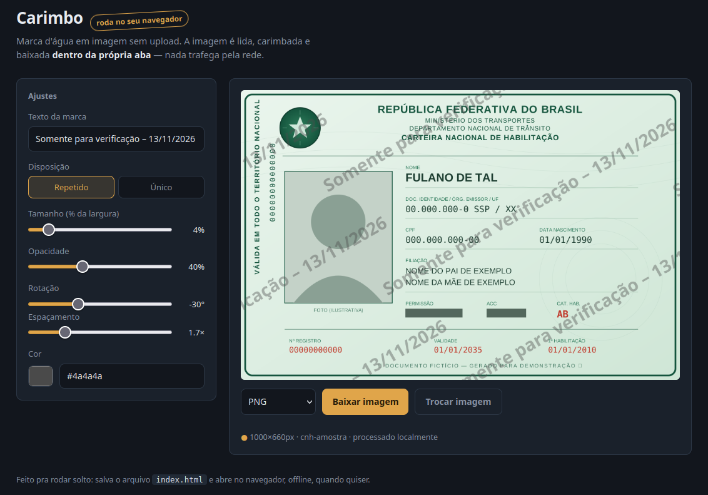

# Carimbo

Marca d'água em imagem direto no navegador. Sem upload, sem servidor, sem conta.

Você solta uma imagem, escreve o texto, ajusta e baixa. A imagem é lida, carimbada e salva **dentro da própria aba** — nada trafega pela rede. Dá pra tirar a internet da tomada e continuar funcionando.

**▶ [Testar ao vivo](https://santosediego.github.io/carimbo/)**

## Por que sem servidor

Marca d'água num documento costuma ser algo que você não quer que vaze. Mandar o arquivo pra um servidor só pra carimbar seria criar exatamente o risco que a marca d'água tenta evitar.

Aqui o processamento é 100% local, via `<canvas>`. O arquivo nunca sai do seu dispositivo. Privacidade não é uma promessa no texto — é como a ferramenta foi construída. O código é aberto justamente pra isso ser auditável: é só canvas e download.

## O que dá pra fazer

- **Disposição repetida** (padrão diagonal clássico de documento) ou **marca única** num canto ou no centro
- Ajuste de texto, tamanho, opacidade, rotação, cor e espaçamento
- Pré-visualização ao vivo
- Exportação na **resolução original** da imagem, não na do preview
- Formatos de entrada: PNG, JPG e WebP
- Saída em **JPG** (menor, padrão para fotos) ou **PNG** (sem perda). Por padrão acompanha o formato da imagem original.
- Já abre com um padrão pra documentos: "Somente para verificação" com a data do dia, em cinza discreto, repetido na diagonal. Na maioria dos casos é soltar a imagem e baixar.

## Como usar

**Online:** abra o link do GitHub Pages e use.

**Local:** baixe o `index.html` e abra no navegador. Funciona offline — dá até pra salvar no celular e usar sem sinal.

Não tem build, não tem dependência, não tem instalação. É um arquivo só.

## Stack

HTML, CSS e JavaScript puro. Zero dependências, zero frameworks. A manipulação de imagem usa a Canvas API nativa do navegador.

## Autor

[Diego Santos](https://www.linkedin.com/in/santosediego/ "Perfil Linkedin Diego Santos")